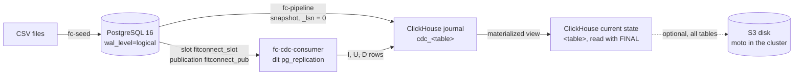

# FitConnect Pipeline: PostgreSQL to ClickHouse with CDC

[](https://github.com/tryph0n/fitconnect-oltp-olap-k8s/actions/workflows/ci.yml)
[](https://github.com/tryph0n/fitconnect-oltp-olap-k8s/actions/workflows/k8s.yml)

Learning project from a data engineering training course.

A sibling project, [fitconnect-dbt-duckdb](https://github.com/tryph0n/fitconnect-dbt-duckdb), uses the same fictional data with another stack: S3, PostgreSQL and dbt with DuckDB.

OLTP-to-OLAP pipeline for a fitness application. PostgreSQL is the transactional source. dlt loads a first snapshot of each table into ClickHouse, then a change data capture (CDC) consumer reads the PostgreSQL replication slot and sends each insert, update and delete to ClickHouse. Everything runs on Kubernetes (k3d, K3s or any cluster).

## Architecture



- **PostgreSQL 16**: OLTP source with logical replication (`wal_level=logical`).
- **dlt**: `sql_database` loads the snapshot; the verified source `pg_replication` (copied into `pg_replication/`) reads the changes from the slot.
- **ClickHouse**: OLAP destination. For each source table, a journal `fitconnect.cdc_<table>` keeps every change (`_op`, `_lsn`, `_ts`), and a materialized view fills the current state `fitconnect.<table>` (`ReplacingMergeTree`, read with `FINAL`).
- **Kubernetes**: StatefulSets for the databases, Jobs for the one-time steps, one Deployment for the consumer, all in the namespace `fitconnect`.

The design and its test results are in the decision record [docs/adr-cdc.md](docs/adr-cdc.md).

| Step | Entry point | Kubernetes object | What it does |
| --- | --- | --- | --- |
| Seed | `fc-seed` | Job `fitconnect-seed` | Loads the CSV files into PostgreSQL. Skips a table that has rows. |
| CDC setup | `fc-cdc-setup` | Job `fitconnect-cdc-setup` | `REPLICA IDENTITY FULL`, publication, replication slot, ClickHouse tables. |
| Snapshot | `fc-pipeline` | Job `fitconnect-pipeline` | Copies each table once to its journal (`_op = 'I'`, `_lsn = 0`). Needs the slot. |
| Consumer | `fc-cdc-consumer` | Deployment `fitconnect-cdc-consumer` | Reads the slot every 5 s (`CDC_POLL_SECONDS`) and loads the changes. |

## Prerequisites

- A Kubernetes cluster in the current kubectl context, for example [k3d](https://k3d.io) or K3s
- kubectl, make and bash
- Docker, to build the image
- [uv](https://docs.astral.sh/uv/), for the tests and local development

## Quick Start

`make up` deploys to the current kubectl context. Check it first with `kubectl config current-context`.

```bash
k3d cluster create fitconnect --wait
make image                       # builds ghcr.io/tryph0n/fitconnect-pipeline:0.2.0
k3d image import ghcr.io/tryph0n/fitconnect-pipeline:0.2.0 -c fitconnect
make env                         # writes .env with random passwords
make up                          # databases, seed, CDC setup, snapshot, consumer
make demo-cdc                    # one UPDATE and one DELETE, then waits for ClickHouse
```

Without `k3d image import`, the cluster pulls the image from GHCR (see [Image](#image)).

`make help` lists the targets:

| Target | What it does |
| --- | --- |
| `make env` | Writes `.env` from `.env.example` with random passwords. Never overwrites `.env`. |
| `make up` | Deploys everything and waits for each step. `make up S3=moto` puts the ClickHouse tables on S3. |
| `make seed`, `make cdc-setup`, `make pipeline` | Runs one Job again. |
| `make consumer` | Starts the consumer Deployment. |
| `make demo-cdc` | Changes two rows in PostgreSQL and waits until ClickHouse and the slot show them. |
| `make cdc-reset` | New slot, empty CDC tables in ClickHouse, new snapshot (see [Reset](#reset)). |
| `make down` | Deletes the namespace and all its data. |
| `make lint`, `make test` | ruff; unit tests, then integration tests. |
| `make image` | Builds the pipeline image with the tag of the manifests. |

## Step by step

`make up` runs these commands. The order matters: the slot must exist before the snapshot, so that it keeps every change made after the snapshot.

```bash
# .env: run `make env`, or copy .env.example and fill in the four passwords
# (PG_PASSWORD = POSTGRES_PASSWORD, CH_PASSWORD = CLICKHOUSE_PASSWORD)
make env

kubectl apply -f k8s/namespace.yaml
kubectl create secret generic fitconnect-env --from-env-file=.env -n fitconnect

kubectl apply -f k8s/postgres/service.yaml -f k8s/postgres/statefulset.yaml
kubectl apply -f k8s/clickhouse/service.yaml -f k8s/clickhouse/statefulset.yaml
kubectl rollout status statefulset/postgres -n fitconnect --timeout=300s
kubectl rollout status statefulset/clickhouse -n fitconnect --timeout=300s

# Seed: CSV files to PostgreSQL
kubectl apply -f k8s/pipeline/job-seed.yaml
kubectl wait --for=condition=complete job/fitconnect-seed -n fitconnect --timeout=300s

# CDC setup: publication, replication slot, ClickHouse tables
kubectl apply -f k8s/pipeline/job-cdc-setup.yaml
kubectl wait --for=condition=complete job/fitconnect-cdc-setup -n fitconnect --timeout=300s

# Snapshot: PostgreSQL tables to ClickHouse
kubectl apply -f k8s/pipeline/job-pipeline.yaml
kubectl wait --for=condition=complete job/fitconnect-pipeline -n fitconnect --timeout=300s

# CDC consumer
kubectl apply -f k8s/pipeline/deployment-cdc-consumer.yaml
kubectl rollout status deployment/fitconnect-cdc-consumer -n fitconnect --timeout=300s
```

A Job runs once. To run it again, delete it first (`kubectl delete job fitconnect-seed -n fitconnect`), or use the make target.

## Verification

The commands below use two shell helpers. The passwords stay in the pod environment.

```bash
pg() { kubectl exec -n fitconnect postgres-0 -- psql -U postgres -c "$1"; }
ch() {
  kubectl exec -n fitconnect clickhouse-0 -c clickhouse -- \
    sh -c 'clickhouse-client --password "$CLICKHOUSE_PASSWORD" -d fitconnect -q "$1"' sh "$1"
}
```

### Row counts

After `make up`, before the demo:

```bash
pg "SELECT 'User' AS t, count(*) FROM \"User\"
    UNION ALL SELECT 'Profile', count(*) FROM \"Profile\"
    UNION ALL SELECT 'Exercise', count(*) FROM \"Exercise\"
    UNION ALL SELECT 'Workout', count(*) FROM \"Workout\"
    UNION ALL SELECT 'WorkoutExercise', count(*) FROM \"WorkoutExercise\""

ch "SELECT 'user' AS t, count() FROM user FINAL
    UNION ALL SELECT 'profile', count() FROM profile FINAL
    UNION ALL SELECT 'exercise', count() FROM exercise FINAL
    UNION ALL SELECT 'workout', count() FROM workout FINAL
    UNION ALL SELECT 'workout_exercise', count() FROM workout_exercise FINAL"
# Expected: user 10, profile 10, exercise 10, workout 104, workout_exercise 426
```

`make demo-cdc` deletes one `WorkoutExercise` row each time, so the last count goes down by one per demo.

### Sample data

PostgreSQL keeps the source column names (`"UserID"`). dlt writes them in snake_case in ClickHouse (`user_id`).

```bash
# PostgreSQL: first 5 users
pg 'SELECT "UserID", "Username", "Email", "JoinDate" FROM "User" ORDER BY "UserID" LIMIT 5'

# PostgreSQL: workouts per user
pg 'SELECT u."Username", count(w."WorkoutID") AS workouts
    FROM "User" u JOIN "Workout" w ON u."UserID" = w."UserID"
    GROUP BY u."Username" ORDER BY workouts DESC'

# ClickHouse: first 5 users
ch "SELECT user_id, username, email, join_date FROM user FINAL ORDER BY user_id LIMIT 5"

# ClickHouse: workouts per user, with average calories
ch "SELECT u.username, count() AS workouts, round(avg(w.calories_burned), 1) AS avg_cal
    FROM (SELECT user_id, calories_burned FROM workout FINAL) AS w
    JOIN (SELECT user_id, username FROM user FINAL) AS u ON w.user_id = u.user_id
    GROUP BY u.username ORDER BY workouts DESC"
```

### CDC verification

```bash
# Replication slot: confirmed_flush_lsn moves forward each time the consumer confirms changes.
# active is f between two runs: the consumer connects to the slot only to read.
pg "SELECT slot_name, plugin, active, wal_status, confirmed_flush_lsn FROM pg_replication_slots"

# Publication: the 5 tables
pg "SELECT pubname, tablename FROM pg_publication_tables"

# Consumer log: one line per run
kubectl logs -n fitconnect deployment/fitconnect-cdc-consumer --tail=5
```

`make demo-cdc` changes the status of user 1 and deletes the first `WorkoutExercise` row. Then it waits until ClickHouse shows both changes and the slot has confirmed them (sample output):

```text
Before
  PostgreSQL User 1 AccountStatus:      Active
  ClickHouse user 1 account_status:     Active
  ClickHouse workout_exercise rows:     426
  PostgreSQL WorkoutExercise rows:      426
  Slot fitconnect_slot confirmed_flush_lsn: 0/15784E8
PostgreSQL: UPDATE User 1 AccountStatus = 'demo-1795459579'; DELETE WorkoutExercise (1, 2)
ClickHouse shows both changes after 3 s
After
  PostgreSQL User 1 AccountStatus:      demo-1795459579
  ClickHouse user 1 account_status:     demo-1795459579
  ClickHouse workout_exercise rows:     425
  PostgreSQL WorkoutExercise rows:      425
  Slot fitconnect_slot confirmed_flush_lsn: 0/15B9EF8
```

The journal keeps the history. The snapshot row has `_lsn = 0`, and each change has a higher `_lsn`:

```bash
ch "SELECT _op, _lsn, _ts, account_status FROM cdc_user WHERE user_id = 1 ORDER BY _lsn"

# No change twice in the journals (expected: 0). A repeat shows only until ClickHouse merges the parts.
ch "SELECT (SELECT count() - uniqExact(user_id, _lsn) FROM cdc_user)
         + (SELECT count() - uniqExact(profile_id, _lsn) FROM cdc_profile)
         + (SELECT count() - uniqExact(exercise_id, _lsn) FROM cdc_exercise)
         + (SELECT count() - uniqExact(workout_id, _lsn) FROM cdc_workout)
         + (SELECT count() - uniqExact(workout_id, exercise_id, _lsn) FROM cdc_workout_exercise)"
```

## Optional S3 storage

`make up S3=moto` stores the ClickHouse tables on an S3 disk:

- `k8s/s3-moto/` runs [moto](https://github.com/getmoto/moto), a local S3 server, in the cluster.
- `k8s/clickhouse/configmap.yaml` adds the S3 disk and makes it the default storage policy. It reads the endpoint and the keys from the `S3_*` values in `.env`.
- `k8s/clickhouse/s3-patch.yaml` mounts this configuration and adds an init container that creates the bucket.

moto keeps the objects in memory. When the moto pod stops, the data is lost and the ClickHouse tables on S3 no longer work: run `make down` and `make up S3=moto` again.

Check that all tables are on S3 (expected: `s3` only):

```bash
ch "SELECT DISTINCT disk_name FROM system.parts WHERE database = 'fitconnect' AND active"
```

### Use AWS S3 instead

1. Create the bucket.
2. In `.env`, set `S3_ENDPOINT` to the AWS form (`https://<bucket>.s3.<region>.amazonaws.com/clickhouse/data/`) and the keys of an IAM user that can read and write the bucket.
3. Delete the `initContainers` block in `k8s/clickhouse/s3-patch.yaml` (its unsigned request works only with moto).
4. Deploy with the step-by-step commands, but replace the ClickHouse lines with:

```bash
kubectl apply -f k8s/clickhouse/configmap.yaml -f k8s/clickhouse/service.yaml
kubectl patch --local -f k8s/clickhouse/statefulset.yaml \
  --patch-file k8s/clickhouse/s3-patch.yaml -o yaml | kubectl apply -f -
```

AWS can charge for S3 storage and requests.

## Image

The manifests use `ghcr.io/tryph0n/fitconnect-pipeline:0.2.0` (the version in `pyproject.toml`) with `imagePullPolicy: IfNotPresent`. The workflow `.github/workflows/image.yml` pushes it to GHCR:

| Event | Tags |
| --- | --- |
| Push to `main` | `sha-<short commit>`, `main` |
| Tag `v<version>` | `<version>`, `sha-<short commit>` |

To build it yourself:

```bash
make image                                                    # docker build with the manifest tag
k3d image import ghcr.io/tryph0n/fitconnect-pipeline:0.2.0 -c <cluster>
# K3s: docker save ghcr.io/tryph0n/fitconnect-pipeline:0.2.0 | sudo k3s ctr images import -
```

A new version changes `version` in `pyproject.toml` and the image tag in the four files of `k8s/pipeline/` (a unit test checks that they agree), then gets the Git tag `v<version>`.

## Local development

```bash
uv sync
uv run pytest -q                    # unit tests
uv run pytest -q -m integration     # PostgreSQL and ClickHouse in containers (needs Docker)
make lint
```

To run an entry point on your machine against the cluster databases, forward the ports and override the hosts of `.env`:

```bash
kubectl port-forward -n fitconnect svc/postgres 5432:5432 &
kubectl port-forward -n fitconnect svc/clickhouse 9000:9000 8123:8123 &
PG_HOST=localhost CH_HOST=localhost uv run fc-pipeline
```

Only one consumer may read the slot. Before you run `fc-cdc-consumer` on your machine, stop the one in the cluster: `kubectl scale deployment/fitconnect-cdc-consumer -n fitconnect --replicas=0`.

## Limitations

- `TRUNCATE` and schema changes (DDL) are not replicated. After a schema change, run `make down`, then `make up`: a [reset](#reset) keeps the old table structure.
- The journal is at least once: after a crash during a load, the same change can be stored again until ClickHouse merges the parts. The current state is not affected. Read the tables with `FINAL` for exact counts.
- `_ts` is the time the consumer read the change, not the commit time.
- One consumer only: the Deployment has one replica and the `Recreate` strategy.
- A slot that nobody reads keeps WAL. PostgreSQL runs with `max_slot_wal_keep_size=256MB`: past this size, the slot is lost and the consumer stops with an error.
- ClickHouse 24.8 is the version of the first project. It no longer gets updates.
- The S3 option with moto keeps the data in memory only.

## Reset

`make cdc-reset` starts the CDC again from a new snapshot, for example after a lost slot:

1. It stops the consumer (`replicas=0`).
2. It runs `fc-cdc-setup --reset` in the Job `fitconnect-cdc-reset`: drops the slot, empties the ClickHouse CDC tables and the stored position, then creates the slot again. The tables keep their structure.
3. It runs the snapshot Job (`make pipeline`).
4. It starts the consumer again.

To delete everything, run `make down` (it deletes the namespace, the volumes and the data), then `make up`.

## Security

This setup is a demo. `make env` writes random passwords to `.env`, and `.gitignore` keeps `.env` out of Git. The services have no TLS and are reachable only inside the cluster. Do not use these manifests as they are for production.

## Data

The dataset contains 560 rows across 5 tables: 10 users, 10 profiles, 10 exercises, 104 workouts, and 426 workout exercises.

Fictional sample data for the FitConnect case study, supplied with a Jedha training course exercise. No licence stated by the source. Not covered by the code licence.

The course exercise, "From Google Analytics to PostgreSQL", used Airbyte and Snowflake. This project does the same transfer with dlt and ClickHouse.

## License

The code is under the MIT License. See [LICENSE](LICENSE).

`pg_replication/` is a copy of the dlt verified source `pg_replication` (version 1.0.2, from [dlt-hub/verified-sources](https://github.com/dlt-hub/verified-sources)). It is under the Apache License 2.0: see `pg_replication/LICENSE.txt`.
